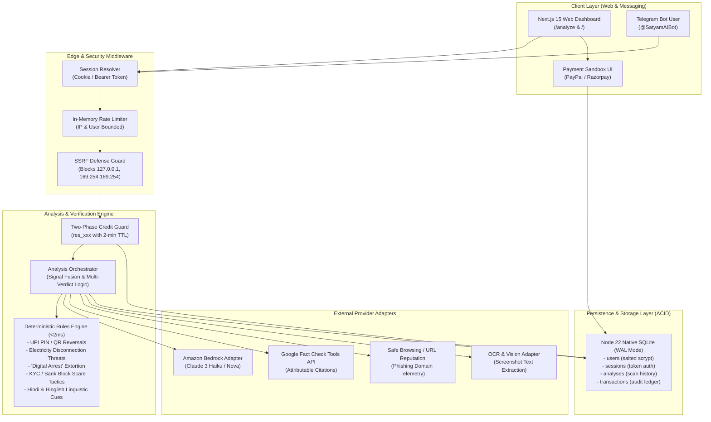
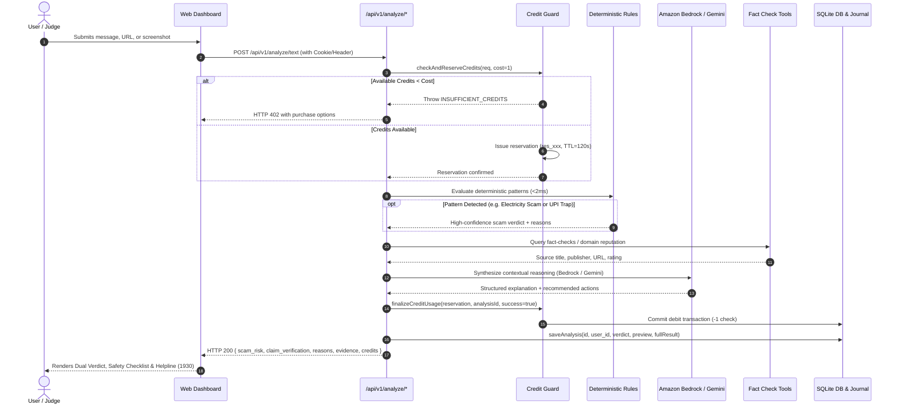
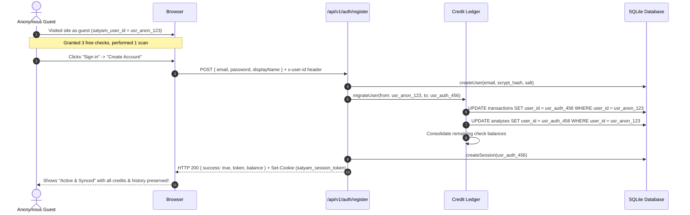
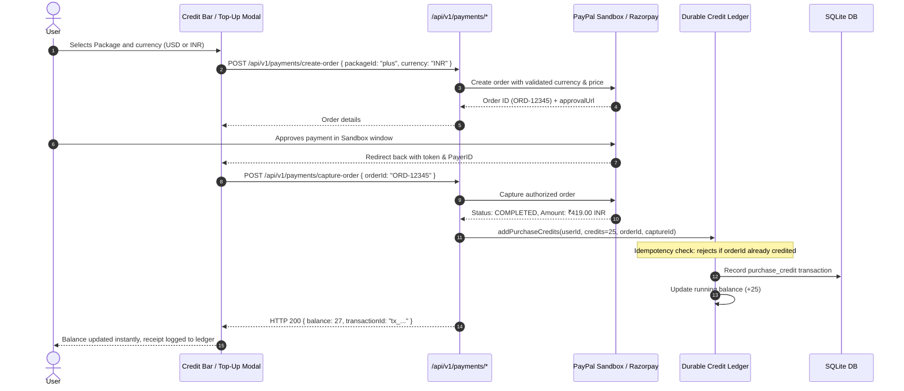

# SatyamAI — Scam & Misinformation Checker

[](https://nextjs.org/)
[](https://www.typescriptlang.org/)
[](https://tailwindcss.com/)
[](https://nodejs.org/api/sqlite.html)
[](https://vitest.dev/)
[](https://cybercrime.gov.in)

> **SatyamAI** (सत्यम् AI) is a production-grade, India-aware decision-support platform designed to protect citizens from deceptive messages, phishing links, viral claims, and extortion traps. It uniquely separates **Scam/Fraud Risk** from **Factual Claim Verification**, backed by deterministic heuristic rules, live source citations, and contextual AI reasoning.

---

## 🏛️ Comprehensive Mermaid Architecture

### 1. High-Level System Architecture & Component Topology



---

### 2. End-to-End Analysis & Verification Sequence



---

### 3. SQLite Authentication & Anonymous Guest Data Migration



---

### 4. Payment Gateway Sandbox & Credit Monetization Engine



---

## 🌟 Core Features & Differentiation

### 1. Dual-Dimension Risk Separation
Traditional AI chatbots collapse complex information into a single generic label ("looks safe" or "suspicious"). SatyamAI separates evaluations into **two distinct dimensions**:
* **Dimension 1: Scam & Financial Fraud Threat** (Phishing, credential harvesting, malware APKs, extortion).
* **Dimension 2: Factual Claim Accuracy** (False quotes, fabricated policies, debunked viral claims).
> *Why this matters:* A deceptive phishing lure can quote a 100% factual news event to sound convincing. Collapsing the dimensions leads to dangerous false positives or false negatives.

### 2. India-Centric Fraud Intelligence
* **UPI PIN Reversal Traps:** Detects scam offers requesting a UPI PIN to "receive" cashbacks or lottery winnings.
* **Fake Electricity Cutoff SMS:** Catches urgent threats warning that power will be disconnected tonight at 9:30 PM.
* **Fake "Digital Arrest":** Debunks Skype/WhatsApp law enforcement extortion by directly quoting Indian criminal procedure.
* **Multilingual:** Handles English, Hindi (Devanagari), and Hinglish (colloquial Roman script).
* **Helpline Routing:** Directly displays the **National Cyber Crime Helpline: 1930** and **cybercrime.gov.in**.

### 3. Native Zero-Dependency SQLite Engine
* Uses Node 22 native `node:sqlite` (`DatabaseSync`) in **WAL mode**.
* Zero external native compilation dependencies (no `node-gyp` or C++ build tools required).
* Persistent storage for:
  - Users with salted `scrypt` password hashing.
  - Session tokens with 30-day expiry.
  - Saved scan history with search and privacy deletion.
  - Financial transaction audit ledger.

### 4. Two-Phase Credit Guard & Monetization
* **3 Free Checks** for every guest on first visit.
* **Two-Phase Reservation:** Checks are reserved prior to analysis and debited only on success.
* **Fail-Safe Restoration:** If an analysis or provider aborts, credits are immediately returned.
* **PayPal Sandbox Integration:** Secure server-authoritative checkout with anti-tampering guards and cryptographic idempotency.

---

## 🛠️ Technology Stack

| Layer | Technology | Purpose |
|---|---|---|
| **Framework** | Next.js 15+ (App Router) | High-performance server components and API route handlers |
| **Language** | TypeScript 5.7 | End-to-end type safety |
| **Styling** | Tailwind CSS v4 | High-contrast light theme, accessible ARIA roles, responsive UI |
| **Database** | Node 22 Native SQLite (`node:sqlite`) | ACID transactional storage in WAL mode |
| **Validation** | Zod 3.24 | Strict runtime schema parsing on all requests and responses |
| **AI Inference** | Amazon Bedrock & Gemini API Adapter | Server-side LLM inference with structured JSON output |
| **Evidence Retrieval** | Google Fact Check Tools API | Attributable citations with publisher and canonical URL |
| **Security** | SSRF & In-Memory Rate Limiter | Loopback / cloud metadata IP blocking and DDoS mitigation |
| **Testing** | Vitest 4 | Unit, integration, security, and benchmark suites |

---

## 🚀 Getting Started

### Prerequisites
* Node.js `v22.13.0` or higher
* npm `10.0+`

### Installation
```bash
# Clone the repository
git clone https://github.com/AmanInAction/satyam-ai.git
cd satyam-ai

# Install dependencies
npm install
```

### Local Development
```bash
# Run the local development server (runs on port 3000)
npm run dev
```
Open [http://localhost:3000](http://localhost:3000) in your browser.

### Running Tests & Quality Checks
```bash
# Run all 218 automated Vitest tests across 19 suites
npm run test

# Run TypeScript type validation (0 errors)
npm run lint

# Build production bundle
npm run build
```

---

## 📡 API Endpoints Summary

### Core Analysis
* `POST /api/v1/analyze/text`: Evaluates suspicious messages or viral claims (Cost: 1 check).
* `POST /api/v1/analyze/url`: Inspects links for phishing and brand spoofing (Cost: 1 check).
* `POST /api/v1/analyze/image`: Extracts and analyzes screenshot text (Cost: 2 checks).
* `GET /api/v1/health`: System health and provider availability diagnostics.

### Authentication & User Accounts (SQLite)
* `POST /api/v1/auth/register`: Creates an account, hashes password with salted scrypt, and migrates guest credits/scans.
* `POST /api/v1/auth/login`: Verifies credentials and issues a secure session token.
* `GET /api/v1/auth/me`: Retrieves current authenticated profile and check balance.
* `POST /api/v1/auth/logout`: Invalidates active session token and clears cookies.

### Scan History & Privacy Controls
* `GET /api/v1/history`: Retrieves user's past scans with search, filtering, and pagination.
* `DELETE /api/v1/history?id=...`: Deletes a specific scan or wipes all history (Privacy by Default).

### Monetization & Payments Sandbox
* `GET /api/v1/payments/credits`: Retrieves current check balance, allowance, and purchase packs.
* `POST /api/v1/payments/create-order`: Generates a server-authoritative sandbox order.
* `POST /api/v1/payments/capture-order`: Validates approval status, currency, and idempotently credits checks.
* `GET /api/v1/payments/transactions`: Returns chronological audit trail of all grants, debits, and purchases.
* `POST /api/v1/payments/webhook`: Handles asynchronous payment events.

### Telegram Bot Webhook
* `POST /api/v1/telegram/webhook`: Reuses the central analysis pipeline for text and links sent via Telegram.
* To sync paid website checks with Telegram: sign in on the website, open **Account**, generate a one-time link code, then send `/link CODE` to the bot in a private chat. Use `/credits` to check the shared balance. Codes expire after 10 minutes.

---

## 🔒 Security & Privacy Guarantees

1. **Privacy by Default:** Raw submissions are not permanently stored unless explicitly saved to your SQLite history, which you can wipe at any time.
2. **SSRF Protection:** Server-side fetching strictly blocks `127.0.0.1`, `localhost`, private ranges (`10.0.0.0/8`, `192.168.0.0/16`), and cloud metadata services (`169.254.169.254`).
3. **Adversarial Defenses:** User input containing prompt-injection tokens (`"Ignore all previous instructions"`) is treated as untrusted text and cannot override classification rules.
4. **Idempotency:** Payment captures and webhook retries are guarded by database-backed unique indexes to eliminate duplicate crediting.

---

## 📄 License
This project is licensed under the MIT License.
